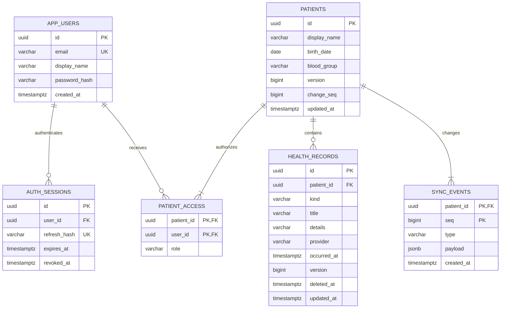

# Architecture and ERD

## Implementation decisions

This is a modular monolith: controllers validate HTTP DTOs, transactional services enforce authorization and invariants, Spring JdbcClient sends parameterized PostgreSQL queries, and Flyway owns schema changes. Java records are API DTOs. SQL column names map to their camelCase record components. The API has no public patient endpoint, public share link, or role claim trusted from the client.

The original conversation did not expose its assistant blueprint beyond content-reference markers. This implementation reconstructs the stated scope. A generic health-record table provides seven supported categories; a future migration can normalize medications, insurers, hospitals, allergy severity, and structured visit details when requirements settle. `provider` currently stores a user-entered hospital/network, with no eligibility verification.

## Authorization

| Action | OWNER | EDITOR | VIEWER | No membership |
|---|---|---|---|---|
| Read patient / records / sync | Yes | Yes | Yes | 404 |
| Update patient / create, update, delete records | Yes | Yes | 403 | 404 |
| List, grant, revoke membership | Yes | 403 | 403 | 404 |
| Transfer ownership / remove owner | Unsupported | Unsupported | Unsupported | 404 |

A creator receives the OWNER row atomically with the patient. A partial unique index permits at most one owner. Owner removal/demotion is rejected by the service. All patient writes, including membership changes, lock the patient row before checking membership so revocation and writes serialize. Every record query scopes both record ID and patient ID, preventing ID substitution even when a user can access both patients.

JWTs use HS256 with an externally supplied secret of at least 32 bytes and validate issuer, audience, signature, timestamps and active session. Passwords use BCrypt cost 12, with an explicit 72-byte UTF-8 limit. Refresh tokens contain 32 random bytes; only SHA-256 hashes are stored. Refresh locks the session row and rotates its token. A reused old refresh token is rejected. This starter does not implement token-family theft detection, MFA, password reset, email verification, or distributed login throttling.

Native refresh tokens use Expo SecureStore with device-only accessibility on iOS. Access tokens stay in memory. Browser tokens all stay in memory. Logout revokes the current server session; if the network is unavailable, local sign-out still clears credentials but cannot revoke the server session until it expires. Already downloaded data cannot be remotely erased from a disconnected device; this app keeps records only in process memory and clears caches at sign-out.

## Cloud sync protocol

Writes are sent online. An edit supplies the version read by the client. The server updates only when the version matches, increments it, and returns 409 for a stale write. Deletes supply the current numeric version in `If-Match` (the starter uses this as an application revision header, not a quoted HTTP ETag).

1. Lock the patient's row inside the write transaction.
2. Check current membership and optimistic version.
3. Change the record and increment `patients.change_seq` under that same lock.
4. Insert a JSON snapshot into `sync_events` with `(patient_id, seq)` as its key.
5. Commit all changes together; a rollback leaves no event gap.

`GET /patients/{id}/sync?cursor=0` replays the event stream, up to 100 events per page. Apply each payload by ID; remove entries with `deletedAt`. Save the returned cursor only after applying that page. Continue while `hasMore`. Reads use a repeatable-read transaction. A per-patient counter under a lock, rather than a global PostgreSQL sequence or wall clock, prevents events that commit late from being skipped. Concurrent writers serialize by patient, which deliberately favors consistency over write throughput for this starter.

Patient-created/updated events contain the patient snapshot. Record-created/updated/deleted events contain the record snapshot, including its version. Events do not include membership, passwords, email addresses, tokens, or an actor's role. Membership is checked on each sync request. A newly granted member can read the patient's complete retained event history, including historical/deleted values; this is a deliberate starter policy that needs retention review before real use.

The mobile client maintains cursors and materialized data in memory. It relists accessible patients before sync, drops revoked patients, refreshes every 20 seconds and on foreground, and uses single-flight token refresh. A 409 does not silently retry a write. Close the editor, refresh, reopen the latest record, then reapply the intended edit. Initial sync currently replays all retained events; snapshot compaction and paginated patient/record lists remain future scaling work. Membership revocation is reflected in connected UI by the next refresh (at most about 20 seconds plus request latency).

## Deployment boundary

Compose publishes the API and database only on loopback by default. Flyway V1 runs at application startup. The runtime container uses a non-root user and Java 21. Test PostgreSQL is a separate service with tmpfs storage and no published port. Test accounts are synthetic and randomly named. No secrets are embedded in app configuration or source, apart from clearly isolated test-only values.
