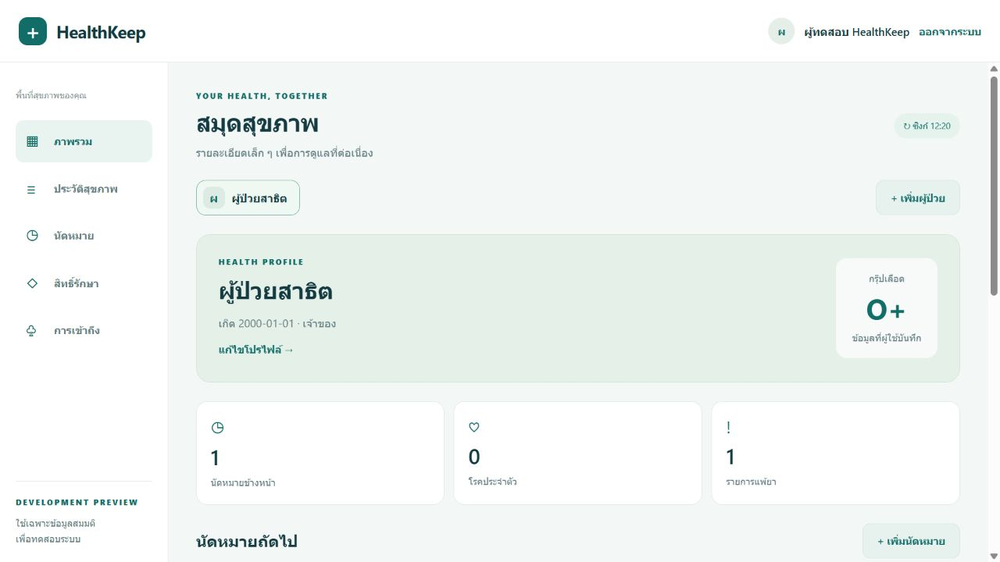
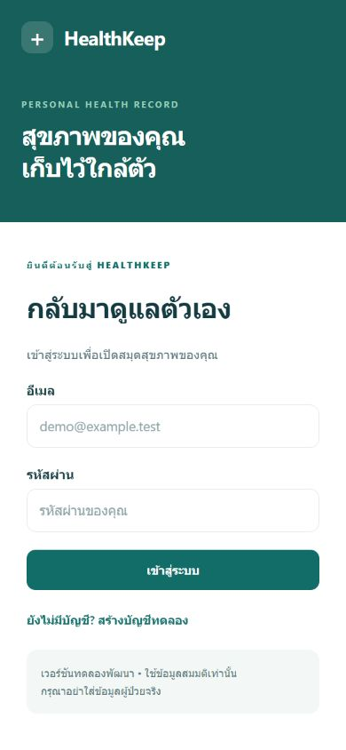
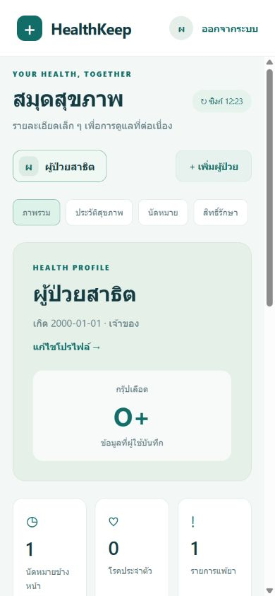
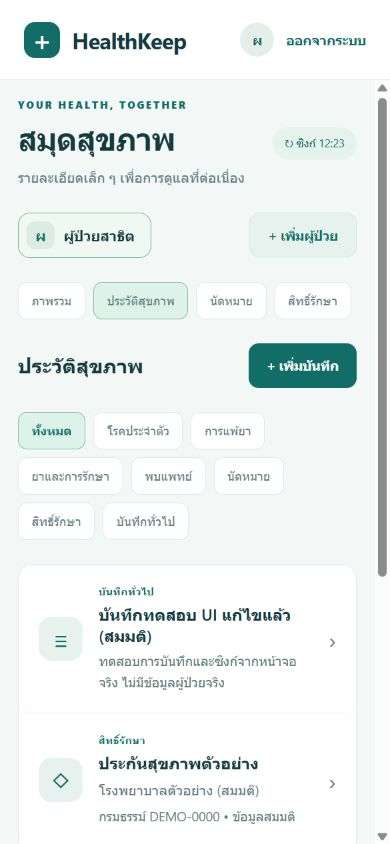

# Verification — 23 October 2026 (Asia/Bangkok)

## Results observed on this machine

| Check | Result |
|---|---|
| VS Code | Verified an actual `App.tsx - healthkeep - Visual Studio Code` window with this project's files open |
| Docker Compose | PostgreSQL and API running and healthy; API on `127.0.0.1:8080`, database on `127.0.0.1:15432` |
| API runtime | Spring Boot 4.1.1 on Java 21.0.12.1; `/actuator/health` returns `UP` |
| Database migration | Flyway V1 applied successfully to PostgreSQL 17.11 |
| HTTP integration suite | **7 tests, 0 failures, 0 errors, 0 skipped**, using a separate real PostgreSQL test database |
| TypeScript | `npm run typecheck` passed |
| Lint | `npm run lint` passed |
| SDK dependency compatibility | `expo install --check` passed against the SDK dependency map |
| Cross-platform bundles | `expo export --platform all --max-workers 2` passed: Web JavaScript and native Hermes bundles for iOS and Android |
| Browser flow | Registration, sign-in, synthetic patient + allergy/appointment/coverage creation, note creation and note update succeeded through the real API |
| Separate browser session | Sign-in in another tab loaded the same patient and updated note from the server |
| Responsive web UI | Desktop and 390×844 mobile layout visually inspected; screenshots below |

The integration tests cover:

1. Authentication required, password validation, invalid login, refresh rotation, old refresh rejection and server-side logout revocation.
2. Unrelated accounts cannot list or read another patient's data, write records, grant access, or sync.
3. VIEWER/EDITOR/OWNER permissions, immutable ownership, membership revocation and immediate API denial after revocation.
4. Optimistic versions (409 on stale edits/deletes), required edit versions, and record IDs scoped to their parent patient.
5. Ordered sync pagination over 103 events, cursor validation, deleted-record tombstones and empty subsequent pages.
6. Blood group, date-of-birth and appointment timestamp validation.
7. CORS preflight allows the configured origin and rejects an untrusted origin.

## Issues found and resolved during verification

- Windows denied binding port 5432. The database is now published on loopback port 15432.
- The first CORS configuration was not attached to the security filter chain. It is now explicitly wired and covered by the seventh integration test. Browser registration and saving were retested successfully.
- React lint checks identified render-time ref/clock access and initial synchronization scheduling. These were fixed without disabling lint rules.
- Mobile sign-in's hero panel collapsed at narrow widths. Its flex sizing was corrected and visually rechecked at 390×844.
- A sandboxed native export could not write Hermes temporary bytecode. The same export succeeded outside the sandbox. Limiting Metro to two workers reduced contention during local checks.

## Remaining limitations

**Native device execution has not been tested.** Bundle generation is not an APK/IPA build or proof of device behavior. There was no connected iOS/Android device or emulator used in this task. SecureStore persistence, native networking, native navigation/back handling and keyboard behavior still need physical-device or emulator testing.

`npm audit fix` applied compatible dependency updates. The final audit still reports **18 high-severity dependency entries, 0 critical** in the Expo/Metro-related dependency graph. The root advisories include [braces stack exhaustion](https://github.com/advisories/GHSA-vfj7-8cjw-p6xm) and [node-forge signature verification](https://github.com/advisories/GHSA-86w9-cpqp-85rv). At the time of checking, the latest returned braces and node-forge versions were still within the reported affected ranges. npm's remaining proposed automatic fix would downgrade Expo to 44.0.6, a breaking change, so it was not applied. These counts include transitive/meta vulnerabilities, not 18 independently verified exploitable app flaws. Reassess and resolve before release; the development servers are bound to localhost.

The API tests ran against synthetic records only. The browser used an `example.test` account and clearly fictional patient, appointment, allergy and coverage records. No real patient information was used. No email, external invitation, app-store upload or deployment was performed. The source repository is https://github.com/tsrirang-jpg/health-keep. Root `.env`, dependency directories and generated bundles are ignored.

See [architecture.md](architecture.md) and the README for online-first sync, retained event history, missing production controls and scope limitations.

## Screenshots from the running application

